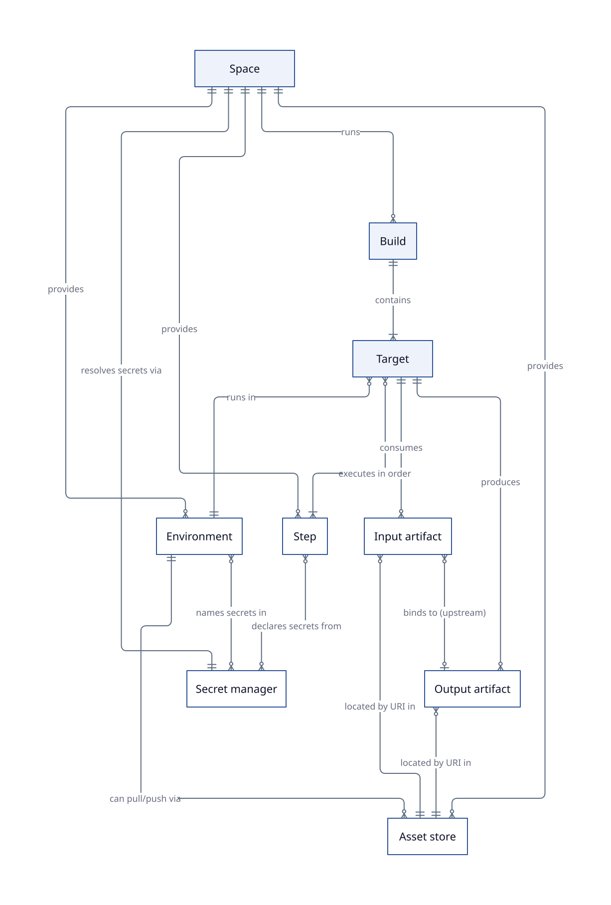
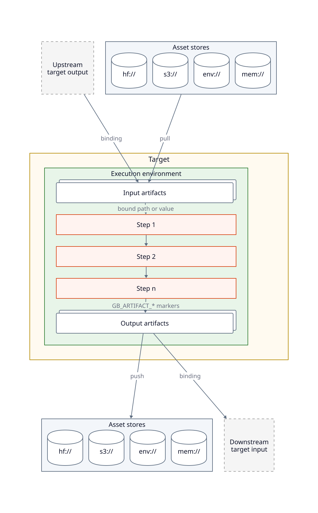
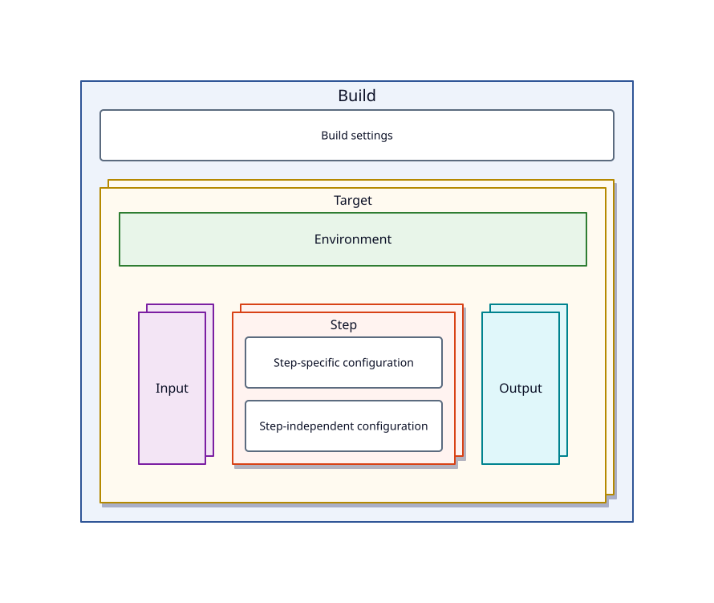

# The Granite.Build `build.yaml` Specification

Repository: <https://github.com/ibm-granite/granite.build>

> **Audience:** engineers and researchers who write, review, or maintain `build.yaml` files, and
> anyone who needs a conceptual map of how Granite.Build runs them. This is the reference for
> the `build.yaml` format: it explains the model behind the file and specifies each part of it,
> field by field, with examples.

**Contents**

- [I. Granite.Build background](#i-granitebuild-background)
  - [I.1 Granite.Build architecture](#i1-granitebuild-architecture)
  - [I.2 Build orchestration](#i2-build-orchestration)
- [II. The `build.yaml` specification](#ii-the-buildyaml-specification)
  - [II.0 Top-level fields](#ii0-top-level-fields)
  - [II.1 Targets](#ii1-targets)
  - [II.2 Environments](#ii2-environments)
  - [II.3 Input and output artifacts](#ii3-input-and-output-artifacts)
  - [II.4 Steps](#ii4-steps)
  - [II.5 Overrides](#ii5-overrides)
  - [II.6 Parameters and Jinja templating](#ii6-parameters-and-jinja-templating)
  - [II.7 Retries](#ii7-retries)
  - [II.8 Validation](#ii8-validation)
- [III. SkyPilot environment specifics](#iii-skypilot-environment-specifics)
  - [III.1 `environment.yaml` configuration](#iii1-environmentyaml-configuration)
  - [III.2 Step execution: environment variables and compute resources](#iii2-step-execution-environment-variables-and-compute-resources)
  - [III.3 Artifacts on SkyPilot](#iii3-artifacts-on-skypilot)
  - [III.4 Steps available for SkyPilot](#iii4-steps-available-for-skypilot)
  - [III.5 SkyPilot overrides](#iii5-skypilot-overrides)
  - [III.6 Example: a three-target SkyPilot pipeline](#iii6-example-a-three-target-skypilot-pipeline)
- [IV. Executing a `build.yaml`](#iv-executing-a-buildyaml)
- [Appendix: glossary and references](#appendix-glossary-and-references)

---

## I. Granite.Build background

Granite.Build turns model-development work into **declarative, reproducible builds**. Data
preparation, synthetic data generation, fine-tuning, distillation, merging, evaluation, and serving
are often run as one-off scripts on a single cluster. Granite.Build has four goals for this work:

- **One declarative file.** A single `build.yaml` describes what to produce, from what, and how,
  so the work can be reviewed, versioned, parameterized and rerun.
- **Portability across compute.** The same build logic runs on a laptop, a Kubernetes cluster, an
  HPC scheduler (SLURM or LSF), or a public cloud. Only the build's environment reference changes.
- **Tracked artifacts.** Every model, dataset and result a build consumes or produces is an
  addressable artifact, recorded with its URI and checksum and linked into lineage.
- **Reuse.** Steps are shared, versioned units of computation, so a team packages a trainer or an
  evaluator once and every build in the space uses it.

### I.1 Granite.Build architecture

A user writes a `build.yaml` and submits it with the **`gb` CLI**. The CLI fills in parameters,
optionally validates the build, and posts it to **gbserver**'s REST API. Inside gbserver a
**BuildWatcher** picks up pending builds and hands each to a **BuildRunner**. The BuildRunner
walks the build's graph of targets. For each target it asks the target's **Environment** to pull
the inputs, launch and monitor each step, and push the outputs. Environments are pluggable
classes, one per compute backend: Bash, Docker, K8s, Lsf, Runpod and Skypilot. Build, target and
step state is persisted (SQLite in standalone mode, PostgreSQL in shared deployments), and build
events are published on an event bus for notifications and the web UI.

```
build.yaml
    │  gb build start
    ▼
gbserver REST API
    │
    ▼
BuildWatcher
    │
    ▼
BuildRunner
    │  walks the target graph
    ▼
Environment
(bash, docker, k8s, lsf, runpod, skypilot)
    │  pull inputs · run steps · push outputs
    ▼
Asset stores
(hf, s3, env, mem, …)
```

#### Capabilities

- **Multiple backends.** Each target picks its compute environment. One build can prepare data on
  a CPU queue, train on a GPU cluster and evaluate on another backend. See
  [II.2 Environments](#ii2-environments) and [III. SkyPilot environment
  specifics](#iii-skypilot-environment-specifics).
- **Artifact stores.** HuggingFace, S3/COS, Git, local files, worker-local paths and in-memory
  values are all addressed by URI. See [Supported URIs](#supported-uris).
- **Retry and reuse.** Builds retry automatically. Retries can reuse the outputs of targets that
  already succeeded, and individual steps can retry as well. See [II.7 Retries](#ii7-retries).
- **Events and lineage.** Build events feed notifications and the web UI. Lineage records which
  artifacts produced which. See
  [Lineage](https://github.com/ibm-granite/granite.build/blob/main/docs/builds/lineage.md) and
  [Event notifications](https://github.com/ibm-granite/granite.build/blob/main/docs/builds/event-notifications.md).
- **Parameterization.** `$${PARAM}` placeholders and Jinja templates let one `build.yaml` serve
  many runs. See [II.6 Parameters and Jinja templating](#ii6-parameters-and-jinja-templating).

#### Build orchestration within a space

Every build runs **in a space**. A space is a named, self-contained context that supplies
everything a build references but does not define inline. A `build.yaml` therefore stays short
and portable with references into the space, for example, 
`space://environments/skypilot/slurm/bluevela` or `space://steps/eval/lmeval`.
The space decides what those names mean, what credentials they use, and where the data lives.
Moving a build to a new team or cluster usually means running it in a different space, not
rewriting it. A build contains executable components called targets and steps (contained within target).
Targets are then executed within an environment defined within the space.

**Space.** A space is a directory with a `space.yaml` at its root. That file names the space,
selects its secret manager, lists `base_uris` (the search path used to resolve `space://` URIs),
and defines `variables` that builds can reference as `space.variables.<key>`. The space's own
directory is searched first, then each base URI in order, then the built-in assets bundled with
gbserver. A space can therefore override any shared environment, step or asset store by shipping
its own copy. Spaces are registered in gbserver by name (`public`, for example), and the CLI and
builds refer to them by that name. For the full `space.yaml` schema, `space://` resolution, and
how to create and register a space, see
[Spaces and `space.yaml`](https://github.com/ibm-granite/granite.build/blob/main/docs/spaces/README.md).

**Secret managers.** Assets never contain credentials. They name secrets such as `HF_TOKEN`,
`COS_ACCESS_KEY_ID` or an SSH key, and the space's secret manager resolves the values at build
time. Four backends are available:

- `local`: file-backed secrets, with optional sync from a remote manager.
- `env`: environment variables, convenient for CI.
- `ibmcloud`: IBM Cloud Secrets Manager.
- `hybrid`: chains several managers in priority order.

On most environments, steps receive only the secrets they explicitly declare (least privilege),
as environment variables. The exceptions are Bash, which loads every space secret into the step's
environment, and RunPod, which has no support for declared secrets (see [II.4](#ii4-steps)).

**Environments.** An environment is a compute backend definition such as an an instance of 
AWS, Slurm, or LSF.  It is defined by an `environment.yaml`
that gives the environment `type` (the Python class that drives it), an optional
`subtype`, a type-specific `config` block, and the list of asset stores (see below) reachable 
from that compute. A `build.yaml` execution block (i.e. target) selects an environment with `environment_uri`. 
The environment owns and executes the target lifecycle: 
setup, launch, monitor and cleanup. It also owns the movement of artifacts to/from 
the available asset stores and the compute.

**Asset stores.** An asset store, defined by a `store.yaml`, describes where artifacts of one URI
family live and how to reach them. It does not move data itself. It covers which URIs it handles,
what endpoint to use, and which secret names hold the credentials. An environment's
`assetstores` block maps each store to its pull (input) and push (output) behavior. The actual
transfer is done by the environment, often by inserting a built-in transfer step such as `hfpull`
or `s3push`. Two stores are implicit everywhere: `env://` (a path already visible to the worker)
and `mem://` (a value passed between targets through the build's shared memory).

**Targets.** Targets are elements of `build.yaml` that define the computation requested
in the compute environment.  It can define input artifacts that are consumed by one or more
steps defined within the target.  The step(s) is then responsible for creating the
results that will be assigned to an output artifact.  Multiple targets may be defined
in a `build.yaml` file. 

**Input artifacts.** An input artifact is a named model, dataset, fileset or value that a target
step consumes. A target declares each input either by URI, for an artifact outside the build such as
`hf:///ibm-granite/granite-4.0-350m`, or by binding to an upstream target's output.
The URI's scheme identifies the asset store, so the target's environment must
be able to reach that store. Targets then refer to each input by name (see
[Referencing inputs within the target](#referencing-inputs-within-the-target)).

**Output artifacts.** An output artifact is a named result that a target step produces. Its URI
identifies the asset store to receive the output content, for example a HuggingFace repository.
Steps are responsible for assigning the output value (see
[Outputs and how steps produce them](#outputs-and-how-steps-produce-them)).

**Steps.** A step is a reusable unit of computation, defined by a `step.yaml`. A step declares
its default configuration, the inputs it accepts, and, per environment class, the **launcher**
that starts it and the **monitors** that watch its logs for status and artifact events. Steps
are resolved relative to the active environment, so `space://steps/command` can mean a bash
script on one backend and a SkyPilot task on another.

The diagram below shows how these entities relate.



Line ends use crow's-foot notation: a double bar means exactly one, a circle with a bar means zero
or one, a circle with a fork means zero or more, and a bar with a fork means one or more.

<!-- Diagram source: docs/images/space-entities.d2. Regenerate with:
     d2 --layout elk docs/images/space-entities.d2 docs/images/space-entities.svg -->

---

### I.2 Build orchestration

A **build** is a directed acyclic graph of **targets**. A target is one logical stage of work,
such as "download", "fine-tune", "evaluate" or "publish". A target:

- takes **zero or more input artifacts**;
- produces **zero or more output artifacts**;
- runs **one or more steps** in order;
- runs **within a single execution environment**.

A target with no inputs is a source, for example a data-generation stage. A target with no
outputs is a sink, for example a smoke test or a notification. Each step in the target runs on
the target's environment, and all the steps share the target's inputs and its per-run working directory.

Targets are joined by **bindings**. When a target's input says
`binding: train.checkpoint`, the BuildRunner treats it as an edge from the `train` target's
`checkpoint` output to this input. The consumer target starts only when the producer has emitted
that artifact. Targets with no path between them run concurrently. A build can also run only
selected targets (`gb build start -f build.yaml evaluate`), and the runner works out which
upstream targets are needed.

**Inputs, outputs and asset stores.** An artifact is identified by a URI, and the URI scheme
selects an asset store: `hf://` selects the HuggingFace store, `s3://` the S3/COS store, and so
on. A target can use an artifact only if its environment can reach the artifact's store. Before a
target's steps run, the environment **pulls** each input. On SkyPilot, for instance, an `hf://`
input is pulled by a built-in `hfpull` step into a cache on the shared filesystem. The input is
then **bound** to a local path (or, for `mem://`, a value) that the steps can reference. When a
step finishes and reports an output artifact, the environment **pushes** it to the store the
output's URI names (for example an `s3push` to a bucket) and records it. A bound input is pulled
the same way: the upstream output's URI is passed to the consuming target, and the consumer's
environment pulls it through its own asset store. There is no shortcut for bound inputs. Only an
environment's own cache avoids downloading the same artifact again.

Two stores need no configuration and transfer nothing:

- **`env://`** names a path already on the worker's filesystem, such as a shared GPFS directory.
- **`mem://`** passes an opaque value, such as a service URL, through the build's shared memory.

Every environment supports both. Every other store type is supported per environment, as
declared in its `environment.yaml`.



<!-- Diagram source: docs/images/build-target-flow.d2. Regenerate with:
     d2 --layout elk docs/images/build-target-flow.d2 docs/images/build-target-flow.svg -->

---

## II. The `build.yaml` specification

A `build.yaml` is the **only file a user must write** to run work on Granite.Build. It names the
targets, the environment each runs in, the artifacts each consumes and produces, and the steps,
with their configuration. The file is purely declarative: it contains no orchestration logic, and
everything it references by `space://` URI is resolved relative to the active space at run time.

The `gb` CLI uses the file in three ways:

- `gb build validate -f build.yaml` checks the build without running it.
- `gb build describe -f build.yaml --raw` renders it with parameters applied.
- `gb build start -f build.yaml [TARGETS…]` submits it.

Parameters (`--param`, `--param-file`) are applied by the CLI before submission. Templates
(`{{ … }}`) are evaluated by gbserver when each target runs.
For a more detailed discussion of the `gb` CLI, see the
[`gb` CLI reference](https://github.com/ibm-granite/granite.build/blob/main/docs/cli/gb-cli-reference.md).

This section is **environment-neutral**: everything here applies to every environment type.
SkyPilot-specific configuration is collected in [section III](#iii-skypilot-environment-specifics).



A build has one or more targets, and a target has one or more steps and zero or more inputs and
outputs. Each target names its own environment through `environment_uri`, so a single build can
run across multiple compute environments.

<!-- Diagram source: docs/images/build-yaml-containment.d2. Regenerate with:
     d2 --layout elk docs/images/build-yaml-containment.d2 docs/images/build-yaml-containment.svg -->

The parts in brief:

- **Targets** are the named stages of the build, for example `download`, `train`, `evaluate` and
  `publish`. Each has one environment, its inputs and outputs, and an ordered list of steps
  (usually just one). See [II.1 Targets](#ii1-targets).
- **Environments** are referenced, not defined, in the build:
  `environment_uri: space://environments/bash`, `…/docker`, `…/skypilot/kubernetes`,
  `…/skypilot/slurm/bluevela` or `…/skypilot/aws`. The definitions live in the space. See
  [II.2 Environments](#ii2-environments).
- **Input and output artifacts** are named, URI-addressed data, for example an input
  `base_model: {uri: hf:///ibm-granite/granite-4.0-350m}`, an input
  `checkpoint: {binding: train.checkpoint}` or an output
  `results: {uri: s3://my-bucket/evals/run1}`. See
  [II.3 Input and output artifacts](#ii3-input-and-output-artifacts).
- **Steps** are the reusable computations a target runs, for example `space://steps/command`,
  `space://steps/train/hf-peft-sft` or `space://steps/eval/lmeval`. They are configured through
  their `config` block. See [II.4 Steps](#ii4-steps).
- **Overrides** let a build change a step's or environment's defaults without editing either one,
  for example `config.launcher_config.resources.accelerators: "H100:8"`. See
  [II.5 Overrides](#ii5-overrides).

### II.0 Top-level fields

```yaml
granite.build:              # required root key ("llm.build" is the accepted legacy alias)
  version: "0.0.1"          # optional schema version
  name: my-build            # optional human-readable name
  retries:                  # optional build-level retry policy (see II.7)
    max_retries: 0
    target_reuse_enabled: true
  targets:                  # required: map of target name → target (at least one)
    ...
```

| Field | Type | Required | Default | Meaning |
|-------|------|----------|---------|---------|
| `version` | string | no | `0.0.1` | Schema version. |
| `name` | string | no | `""` | Label shown in `gb build list` and the UI. |
| `retries` | object | no | no retries | Build-level retry policy. |
| `targets` | map | **yes** | — | The build's targets, keyed by name. |

### II.1 Targets

A target is declared as a key under `targets`. The key is the target's **name**. Names must be
unique in the build, and they are how bindings (`<target>.<output>`) and the CLI
(`gb build start -f build.yaml <target>`) refer to the target. Use short, descriptive names such
as `prep`, `train` or `eval-mmlu`.

Each target is **assigned to one operational compute environment** through `environment_uri`.
All of its steps execute there, and its inputs are pulled into that environment's reach before
the first step starts. The target's **steps** are what turn its **inputs** into its **outputs**:
they run in list order, each step can read every input binding, and any step can assign any of the
target's declared outputs.

```yaml
targets:
  train:
    environment_uri: space://environments/skypilot/slurm/bluevela
    inputs:
      base_model:
        uri: hf:///ibm-granite/granite-4.0-350m
      dataset:
        binding: prep.dataset
    outputs:
      checkpoint:
        uri: s3://my-bucket/checkpoints/{{ run_metadata.targetsteprun_id | short_hash }}
        type: model
    steps:
      - step_uri: space://steps/train/hf-peft-sft
        config: { ... }
```

| Field | Type | Required | Meaning |
|-------|------|----------|---------|
| `environment_uri` | string (templated, `space.*` only) | **yes** | The compute environment the target runs in. |
| `inputs` | map name → input | no | Artifacts the target consumes ([II.3](#ii3-input-and-output-artifacts)). |
| `outputs` | map name → output | no | Artifacts the target produces ([II.3](#ii3-input-and-output-artifacts)). |
| `steps` | list of step | **yes** | Steps run in order ([II.4](#ii4-steps)). An empty list only produces a validation warning. |

### II.2 Environments

A build does not define environments. It **references** them, and the space supplies the
definitions. `environment_uri` is usually `space://environments/<path>`. It is resolved relative
to the space's `space.yaml` location or its `base_uris` to a directory that contains an
`environment.yaml`. On a standalone server, a `file:` path is also accepted:

- A relative path such as `file:environments/my-env` is looked up from the current directory
  first, then from the build's own directory, so a build can ship its own environment (or step,
  for `step_uri`) next to its `build.yaml`. Found in neither, it fails validation.
- `file:.` means the build's own directory, for an `environment.yaml` placed next to the
  `build.yaml`.
- Write a relative path as `file:<path>`, not `file://<path>`: with two slashes the first
  segment is read as a host name.

The value can use a build parameter
(`space://environments/$${ENVIRONMENT}`) or a space variable
(`space://environments/{{ space.variables.DEFAULT_ENVIRONMENT }}`).

**Supported environment types**

| `type` | Compute | Typical use |
|--------|---------|-------------|
| `Bash` | Local OS process on the gbserver host | Quick starts, tests (standalone only). |
| `Docker` | Local container (Docker/Podman) | Containerized local runs. |
| `K8s` | Kubernetes/OpenShift via Helm + AppWrapper | Native cluster runs with streamed events. |
| `Lsf` | IBM LSF via `bsub` over SSH | HPC clusters with shared filesystems. |
| `Runpod` | RunPod GPU pods | On-demand GPUs. |
| `Skypilot` | SkyPilot: SLURM, Kubernetes, AWS, … | One launcher shape across many clouds ([III](#iii-skypilot-environment-specifics)). |

For the full `environment.yaml` schema, per-step-type defaults, asset-store declarations, and
links to each environment type's own page, see the
[Environments overview](https://github.com/ibm-granite/granite.build/blob/main/docs/environments/README.md).

### II.3 Input and output artifacts

Inputs and outputs are the target's interface. They are also the inputs and outputs of its steps,
which read the bound inputs and assign the declared outputs.

#### Inputs: direct or bound

Each input is exactly one of two kinds:

```yaml
inputs:
  base_model:
    uri: hf:///ibm-granite/granite-4.0-350m     # direct: an external artifact, pulled
  train_data:
    binding: prep.dataset                        # bound: another target's output
    wait_for_push: true                          # optional: wait until upstream's push completes
```

- **A direct input (`uri`)** refers to an artifact outside the build. The environment pulls it
  through the store that matches its scheme.
- **A bound input (`binding: <target>.<output>`)** refers to an output of an **upstream target**
  in the same build. Validation rejects a binding that names a missing target or output. The
  binding creates a dependency edge, so the consumer starts once the producer has emitted the
  artifact. With `wait_for_push: true` it starts only after the artifact has also been pushed to
  its store (default is `false`). The consumer's environment then pulls the upstream output's URI,
  just as it pulls a direct input.

| Field | Type | Required | Default | Meaning |
|-------|------|----------|---------|---------|
| `uri` | string | one of `uri`/`binding` | — | A direct artifact URI (see [Supported URIs](#supported-uris)). |
| `binding` | string | one of `uri`/`binding` | — | `<target-name>.<output-name>`: an upstream target's output. |
| `wait_for_push` | bool | no | `false` | Start only after the upstream output's push has completed. |
| `metadata` | object | no | — | Filled in at run time; usually omitted. |

#### Referencing inputs within the target

Every input, direct or bound, is resolved before the target's steps start. Each one is then
available by its input name through the `bindings` template variable:

- `{{ bindings.<input-name>.binding.path }}` for filesystem artifacts;
- `{{ bindings.<input-name>.binding.state }}` for `mem://` values.

A `build.yaml` can use these expressions in a step's `config` values or the step implementation.
For example, in the `config`:

```yaml
steps:
  - step_uri: space://steps/command
    config:
      command_config:
        command: >-
          python train.py --model {{ bindings.base_model.binding.path }}
                          --data  {{ bindings.train_data.binding.path }}
                          --reward-url {{ bindings.rm_url.binding.state }}
```

A step implementation can also refer to inputs through `bindings` in its own `step.yaml`,
so a build only has to declare target inputs with the names the step expects. See
[Steps — Declaring inputs](https://github.com/ibm-granite/granite.build/blob/main/docs/steps/README.md#declaring-inputs).
Which input names a step expects, and how it passes them to its workload, differ from step to
step. Check the step's own documentation (its `README.md`) or its `step.yaml` before
wiring up a target's inputs.

#### Outputs and how steps produce them

```yaml
outputs:
  checkpoint:
    uri: s3://my-bucket/ckpt/{{ unique_hash }}
    type: model                       # optional artifact type (model, dataset, fileset, …)
  model:
    uri: hf://huggingface.co/my-org/my-model
    public: true                      # hf:// only: publish the repo (default private)
  server_url:
    uri: mem://server_url             # opaque value; type and store_push are ignored
  results:
    uri: env:///proj/shared/evals/run1  # already on the shared filesystem; nothing is pushed
```

A step reports each output it produces by name. How it does so is described in
[Steps — Producing outputs](https://github.com/ibm-granite/granite.build/blob/main/docs/steps/README.md#producing-outputs).
The output's `uri` then decides where the environment pushes the artifact.

| Field | Type | Required | Default | Meaning |
|-------|------|----------|---------|---------|
| `uri` | string | no | — | Where the output is pushed. Templated at push time (see [II.6](#ii6-parameters-and-jinja-templating)). |
| `type` | string | no | — | The artifact type: `model`, `dataset`, `fileset` and so on. |
| `public` | bool | no | `false` | `hf://` only: publish the pushed repository. Repositories are private by default. |
| `store_push` | object | no | — | Push options for the output's store (see below). |

**`store_push`** holds push options for a single output. In practice only the HuggingFace store
reads it, and you rarely need it: an `hf://` URI alone pushes to the right repository.

- `store_push.config.hf` sets HuggingFace push options: `resource_group_id` or
  `resource_group_name` (for Enterprise organizations), `use_resource_group: false` to push
  without a resource group, and `public`. The same `hf` keys can be set for every push in the
  environment's `environment.yaml`, under `assetstores[].push[].config`. A value set on the output
  wins.
- `store_push.mode` is rarely needed, because the store is inferred from the URI's scheme. Only
  K8s honors it; elsewhere it is ignored with a deprecation warning.

See [HuggingFace push](https://github.com/ibm-granite/granite.build/blob/main/docs/builds/hf-push.md)
for resource-group resolution and Enterprise organizations.

#### Supported URIs

The scheme of a URI selects its asset store. `env://` and `mem://` work in every environment.
`hf://` and `s3://` are supported **per environment**: an environment must implement the store's
pull and push and declare the store in its `assetstores`.

| Environment | `hf://` | `s3://` / `cos://` | `env://` | `mem://` |
|-------------|:------:|:-----------------:|:-------:|:-------:|
| Bash | ✓ | — | ✓ | ✓ |
| Docker | ✓ | — | ✓ | ✓ |
| K8s | ✓ | ✓ | ✓ | ✓ |
| Lsf | ✓ | ✓ | ✓ | ✓ |
| Runpod | — | — | ✓ | ✓ |
| Skypilot | ✓ | ✓ | ✓ | ✓ |

##### `hf://` (HuggingFace)

- **Form:** `hf:///<owner>/<repo>[/<revision>[/<path>]]`. The form with a host,
  `hf://huggingface.co/<owner>/<repo>`, is also accepted.
- **Datasets:** dataset repositories need the `datasets/` segment:
  `hf:///datasets/<owner>/<repo>`.
- **Pulling a subset:** naming a path after an explicit revision pulls only that file or
  directory, and the input is bound at that path. For example,
  `hf:///datasets/org/repo/main/data/train` binds the input at `data/train`.
- **Credentials:** the `HF_TOKEN` secret, or whatever name the store configures.
- **Several endpoints:** the URI's host is the endpoint. `hf:///<owner>/<repo>` uses
  `huggingface.co`, and `hf://<host>/<owner>/<repo>` uses `https://<host>`, for example a
  private Hub or a mirror. Different outputs and inputs in one build can therefore use
  different endpoints, with no extra store configuration; every environment's pull and push
  honors the host. Write three slashes for the default host: in `hf://datasets/…`, `datasets`
  would be read as the host.
- **Publishing:** on outputs, `public: true` publishes the pushed repository. Repositories are
  private by default.

##### `s3://` (S3 and IBM COS)

- **Form:** `s3://<bucket>/<key-or-prefix>`. A single object is pulled into the input directory
  under its own name. A prefix is synced into that directory.
- **Pushing:** a file is pushed to the exact key, and a directory is synced under the prefix.
- **Endpoint and credentials:** these come from the matching store's `store.yaml`:
  `cos_endpoint`, an optional `cos_region`, and the secret names for the access key and secret
  key.
- **Several endpoints:** one environment can reach several endpoints by declaring one store per
  endpoint, each with its own `base_uri` prefix. The longest matching prefix wins.
- **`cos://`:** handled by the same store family.

##### `env://` (worker-local filesystem)

- **Form:** `env:///absolute/path`. Relative `env:` URIs are rejected when the build is loaded.
  On an output, `env://{{ binding.path }}` is fine. In an output URI, `binding` is the output's
  own produced path, and it renders to an absolute path.
- **Behavior:** the artifact already lives on a filesystem the worker can see, such as GPFS on an
  HPC cluster. Nothing is transferred. The path is resolved directly.

##### `mem://` (in-memory value)

- **Form:** `mem://<key>`. The key is opaque.
- **Behavior:** the producer emits `GB_ARTIFACT_STATE:<value>` and the consumer reads
  `{{ bindings.<name>.binding.state }}`. The value passes through **verbatim**, with no path
  normalization, so a URL such as `http://host:8000` survives intact.
- **Uses:** handing service URLs, cluster names and similar values between targets.
- **Restrictions:** `type` and `store_push` have no effect on a `mem://` output and are ignored.

##### Other schemes

- `file:` names a path on the gbserver host and is accepted only on a standalone server.
- `git+https://` and `git+ssh://` name a cloned repository, with an optional `#subdirectory=`.

### II.4 Steps

A step is the **reusable unit of computation**. The same `space://steps/train/hf-peft-sft` serves
every build in a space, and its author maintains it in one place. Steps are **implemented and
resolved per environment**. A step's `step.yaml` carries an `environment_configs` section with
one entry per environment class it supports, and the resolver picks the copy that matches the
target's environment. So `space://steps/command` resolves to a bash script under the Bash
environment and to a SkyPilot task under Skypilot. A step that has no implementation for the
target's environment fails validation.

```yaml
steps:
  - step_uri: space://steps/eval/lmeval       # space://, file: (standalone) or git+…
    config:                                   # merged over the step's defaults
      benchmark: mmlu-prox-lite               # step-specific (lmeval's own keys)
      model_path: "{{ bindings.model.binding.path }}"
      compute_config: { num_nodes: 1 }        # step-independent
      poll_interval_seconds: 300              # step-independent (monitor cadence)
    retry_enabled: true                       # step-level retry (II.7)
    retry_transparently: true
```

| Field | Meaning |
|-------|---------|
| `step_uri` | Which step to run. If omitted, the built-in base step `gbstep` is used. |
| `config` | Configuration merged over the step's defaults (see below and [II.5](#ii5-overrides)). |
| `retry_enabled`, `retry_transparently` | Step-level retry behavior. |

**Using the target's inputs.** A step accesses the target's inputs in one of two ways, depending
on the step implementation. It can take them through its `config`, with the bound paths or values
templated into its own fields. Alternatively, the step may expect inputs of a specific name and
reference the bindings inside the step implementation.

**Step-specific and step-independent configuration.** A step's `config` mixes two kinds of block:

- **Step-specific** keys and blocks are defined by the step's author and documented in the
  step's `USAGE.md`. Examples: `command_config.command`, `hf_peft_sft_config.lora.r`, and
  lmeval's top-level `benchmark` and `model_path`.
- **Step-independent** blocks are understood by gbserver or the environment for any step:
  - `compute_config`;
  - `launcher_config`, which overrides the launcher ([II.5](#ii5-overrides));
  - monitor settings such as `poll_interval_seconds`;
  - secret declarations (`config.<env>.secrets`).

**Compute resources.** A step sizes its compute through `config.compute_config`, the
environment-neutral resource request. Each environment reads the fields that make sense for it.

| Field | Read by | Meaning |
|-------|---------|---------|
| `num_nodes` | K8s, LSF, RunPod, SkyPilot | Number of nodes. |
| `num_gpus_per_node` | K8s, LSF, RunPod | GPUs per node. |
| `num_cpus_per_node` | Docker, K8s, SkyPilot | CPU cores per node. |
| `total_memory_per_node` | Docker, K8s, SkyPilot | Memory per node, e.g. `"32Gi"`. |

On LSF, an unset `num_gpus_per_node` means **1** GPU, whereas K8s defaults to 0. A step that needs
no GPU, such as a pull or push step, must set `num_gpus_per_node: 0` on LSF. Otherwise its job
waits for a GPU instead of being scheduled on the normal queue.

Environments with richer resource models, such as SkyPilot, accept additional backend-specific
settings through the step's `launcher_config` (see
[III.2](#iii2-step-execution-environment-variables-and-compute-resources)).

**Environment variables from secrets.** On Docker, K8s, LSF and SkyPilot, secrets are never passed
in bulk. A step declares by name each secret it needs as an environment variable, under an
environment-specific `config` block (`config.docker`, `config.k8s`, `config.lsf` or
`config.skypilot`). The space's secret manager supplies the value. Two environments differ:

- **Bash** loads every space secret into the step's environment, whether the step declares it
  or not.
- **RunPod** has no support for declared secrets.

For example, this target runs on a SkyPilot environment and exposes two space secrets to its
command as `HF_TOKEN` and `WANDB_API_KEY`:

```yaml
steps:
  - step_uri: space://steps/command
    config:
      skypilot:                          # key matches the target's environment type
        secrets:
          secret_names_to_use_as_env_variable:
            - env_name: HF_TOKEN         # environment variable the workload sees
              secret_name: hf_token      # space secret that supplies the value
            - env_name: WANDB_API_KEY    # secret_name omitted: looks up a secret named WANDB_API_KEY
      command_config:
        command: python train.py --report-to wandb
```

- **Only the declared secrets are injected.** A declared secret that the space doesn't have
  fails the launch, and the error message never includes a secret's value.
- **The block has the same shape on every environment.** For another environment, change only
  the outer key, for example `k8s:` or `lsf:`.
- **A step implementation can declare its secrets in its own `step.yaml` instead.** In that case
  the build doesn't need this block at all, although the secrets must still be available in the
  secret manager.

See [Environments — Secrets as environment
variables](https://github.com/ibm-granite/granite.build/blob/main/docs/environments/README.md#secrets-as-environment-variables)
for how each environment delivers the value.

**Non-secret environment variables.** Non-secret environment variables such as tuning knobs, log
levels and feature flags can be set in the step's `config`, through a key specific to the target's
environment type:

| Environment | build.yaml key | Notes |
|-------------|----------------|-------|
| Bash | `config.bash.env` | Overrides the step's launcher `env`. |
| Docker | `config.docker.env` | The step's own launcher `env` takes priority over it. |
| K8s | `config.k8s.env` | Each value must be a quoted string, written `{value: "…"}`. |
| SkyPilot | `config.launcher_config.envs` | Note the plural `envs`. |

For example, the same target can set `NCCL_DEBUG` and `MAX_NEW_TOKENS` on SkyPilot:

```yaml
steps:
  - step_uri: space://steps/command
    config:
      launcher_config:
        envs:
          NCCL_DEBUG: INFO
          MAX_NEW_TOKENS: "512"
      command_config:
        command: python generate.py --max-new-tokens "$MAX_NEW_TOKENS"
```

or on K8s:

```yaml
config:
  k8s:
    env:
      NCCL_DEBUG: { value: "INFO" }
      MAX_NEW_TOKENS: { value: "512" }    # quoted: an unquoted number fails validation
```

On Bash and SkyPilot, values set by the build override the step's own defaults. On Docker, the
step's launcher `env` wins. The variables gbserver injects, such as the `GB_*` run identifiers,
always win. Quote numbers so that every value reaches the workload as a string. Don't put
credentials here: use the secrets block above, so the value comes from the secret manager and is
never written into the build.

### II.5 Overrides

A build can change step and environment defaults **without editing the step or the
environment**. A step's `config` is deep-merged across three layers, lowest priority first. A
later layer wins, nested maps merge key by key, and a list is replaced whole:

1. **`environment.yaml` `config.steps.<step-slug>`**: per-step-type defaults set by the
   environment. The slug is the step URI's last path segment, for example `hfpull`, `command`,
   or `gbstep` for the default step.
2. **`step.yaml` `config`**: the step author's defaults.
3. **`build.yaml` step `config`**: the build's override, which always wins.

In addition, the launcher block a step defines in `step.yaml` (its image, resources,
environment variables, and so on) can be overridden key by key from the build through
`config.launcher_config.*`. The keys available depend on the environment.

```yaml
# environment.yaml (layer 1): send all pull/push steps to the I/O queue
config:
  steps:
    hfpull: { zone: io }
    s3push: { zone: io }

# build.yaml (layer 4): this target's command step gets more memory and a container image
steps:
  - step_uri: space://steps/command
    config:
      command_config: { command: "python run.py", image: "python:3.12-slim" }
      launcher_config:
        resources: { memory: "32+" }
```

A `config.steps.<slug>` key that matches no step in the build is silently ignored. When an
override seems to have no effect, check the slug first. SkyPilot's overridable launcher keys are
listed in [III.5](#iii5-skypilot-overrides).

### II.6 Parameters and Jinja templating

A `build.yaml` can contain two kinds of placeholder. They are filled at different times, by
different parts of the system:

| Placeholder | Filled by | When | Sees |
|-------------|-----------|------|------|
| `$${NAME}` | the `gb` CLI | before the build is submitted | parameter values |
| `{{ … }}` | gbserver | while the build runs, field by field | the variables listed below |

The CLI fills `$${…}` first, by plain text substitution across the whole file, so a parameter
can appear anywhere: in a key, a URI, a number or inside a `{{ … }}` expression. gbserver never
sees `$${…}`. It receives the file with every parameter already replaced and then evaluates
`{{ … }}` as each field is used.

#### Build parameters (`$${NAME}`)

Values are layered, later layers overriding earlier ones:

1. `parameters.yaml` next to the `build.yaml`, if there is one;
2. each `--param-file <file>`, in order;
3. each `--param KEY=VALUE`. A dotted key such as `--param M.y=3` sets one nested key.

Only top-level keys merge, and a later file replaces a list or map whole. `gb build start` and
`gb build validate` write the final values to `parameters-applied.yaml`. To see the rendered build
without submitting it, use `gb build start --dry-run` or `gb build describe --raw --param-file …`.

- The recipe's own `parameters.yaml` is always loaded when it exists, so a malformed one fails
  the build even when you pass other files with `--param-file`.
- Passing that same `parameters.yaml` as a `--param-file` applies it at that position in the
  layering, not also as the base layer.
- Run with `--loglevel DEBUG` to see which file set each key.

#### Jinja templates (`{{ … }}`)

gbserver evaluates `{{ … }}` with [Jinja](https://jinja.palletsprojects.com/). Expressions,
filters and `` blocks all work. Each field is rendered at the moment gbserver needs its
value, and what an expression can see depends on that moment. A variable that doesn't exist yet
at that point can't be used.

Unlike `$${…}`, Jinja is not applied to the whole file. gbserver renders `{{ … }}` only in the
four places below.

**Where templates can appear, and what each place can see:**

| Field in `build.yaml` | Rendered | Variables available | Unknown variable |
|-----------------------|----------|---------------------|------------------|
| `environment_uri`, `step_uri` | when the URI is resolved | `space.*` | error |
| input `uri` | when the input is resolved | `space.*` | error |
| output `uri` | when the output is pushed | `space.*`, `run_metadata.*`, `unique_hash`, `binding.*` | error |
| step `config` values | when the step is prepared, before it launches | `space.*`, `run_metadata.*`, `bindings.*`, `step.name` | left as written |

In step `config`, every string value is rendered, however deeply it is nested in maps or lists.
Keys are not rendered, and a value that isn't a string, such as a number, is left as it is.

Everything else in the file is read as plain YAML. That covers `name`, `version`, `retries`,
`wait_for_push`, target and input names, and every key. A `{{ … }}` in any of them is kept as
literal text, with no error. To vary one of those parts, use a `$${…}` parameter: the CLI
substitutes parameters everywhere in the file before gbserver reads it.

**Variables:**

| Variable | Meaning |
|----------|---------|
| `space.variables.<key>` | A value from the space's `space.yaml` `variables`. |
| `space.name` | The name of the space the build runs in. |
| `run_metadata.<field>` | Identifiers of the current run: `build_id`, `build_config_name`, `username`, `target_name`, `targetrun_id`, `targetsteprun_id`, `target_hash`. |
| `bindings.<input>.binding.path` | The local path of the target's input named `<input>`. |
| `bindings.<input>.binding.state` | The value of a `mem://` input named `<input>`. |
| `binding.path` | In an output `uri` only: the path the step reported for this output. |
| `unique_hash` | In an output `uri` only: a hash of the artifact event that triggers the push. It changes with each push, including a workload step's retry. A push step's retry keeps it, and a build retry that reuses the target keeps the old URI. It may start with a digit, so keep a prefix, as in `eval_{{ unique_hash }}`. |
| `step.name` | The name of the step being configured. |

**Unknown variables.** URIs are rendered strictly, so a misspelled or unavailable variable fails
the build with a template error. Step `config` values are rendered leniently: an unknown name is
left in the value as the literal text `{{ name }}`, and the step receives that text. Check a
`config` value that uses `bindings` against the target's input names, because a misspelled
input name is not reported.

**Filters:** `short_hash` (a short alphanumeric hash, handy for unique names), `path_basename`,
`to_yaml`, `json_dumps` and `indent(N)`, plus Jinja's built-in filters such as `default`. URIs,
which are rendered strictly, can also use `get_file_extension` and `b64encode`; step `config`
values cannot.

**Examples:**

```yaml
targets:
  train:
    # space.* only: pick the environment from a space variable
    environment_uri: space://environments/{{ space.variables.DEFAULT_ENVIRONMENT }}
    inputs:
      base_model:
        uri: hf:///{{ space.variables.BASE_MODEL_ORG }}/granite-4.0-350m
    outputs:
      # run_metadata: a fresh repository for each target run
      checkpoint:
        uri: hf:///my-org/ckpt-{{ run_metadata.targetrun_id | short_hash }}
      # binding.path: register the output where the step wrote it
      results:
        uri: env://{{ binding.path }}
    steps:
      - step_uri: space://steps/command
        config:
          command_config:
            # bindings and run_metadata: wire an input and the run ID into the command
            command: >-
              python train.py --model {{ bindings.base_model.binding.path }}
              --run {{ run_metadata.build_id }}
```

**Mixing with shell syntax.** `{{ … }}` is processed before a command reaches the shell, so
shell variables such as `$HOME` or `${MAX_TOKENS}` pass through untouched. Two character pairs
are special to Jinja, though:

- `{{` starts an expression. A literal `{{` that the command needs, for example in a Go
  template, must be written `{{ '{{' }}`.
- `{#` starts a Jinja comment, so shell syntax such as `${#array[@]}` breaks.

Wrap any such text in `…` to pass it through unchanged.

### II.7 Retries

**Build retry.** `retries.max_retries` restarts a failed build automatically. With
`target_reuse_enabled: true` (the default), targets that already succeeded are skipped and their
outputs reused. `gb build restart <id>` does the same on demand.

**Step retry.** `retry_enabled` on a step overrides the step's own retry setting. Step retry as a
whole is controlled server-side by `GBSERVER_ENABLE_STEP_RETRY` (default `true`).
`retry_transparently` controls artifact events across retry attempts:

- `true` (the default) removes duplicate artifact events, so an artifact re-reported by a retry
  is not registered twice;
- `false` passes every event from every attempt through.

For the full mechanism, see
[Retry overview](https://github.com/ibm-granite/granite.build/blob/main/docs/builds/retry.md),
[Build retry](https://github.com/ibm-granite/granite.build/blob/main/docs/builds/build-retry.md),
[Target reuse](https://github.com/ibm-granite/granite.build/blob/main/docs/builds/target-reuse.md)
and
[Step retry configuration](https://github.com/ibm-granite/granite.build/blob/main/docs/builds/step-retry-configuration.md).

### II.8 Validation

`gb build validate -f build.yaml` (with the same `--param`/`--param-file` options as `start`)
reports errors before anything runs. `gb build start` validates as well, unless you pass
`--skip-validation`. Common rejections:

- an input with neither `uri` nor `binding`, or with both;
- a `binding` that names a target or output that doesn't exist;
- a step or environment URI that cannot be resolved in the space (`Unresolvable space uri`);
- a `file:` URI on a non-standalone server, in a target's `environment_uri`, a step's
  `step_uri`, or an input or output `uri`. A `step_uri` or `environment_uri` with no scheme
  counts as `file:`. On a shared server, use `space://`, a git URI or `env://` instead;
- a `..` path segment in a `step_uri` or `environment_uri`, on any server, checked after the
  space's templates are filled. This covers `space://steps/../x`, `file:../x` and a git
  `#subdirectory=../x`. Dots inside a name, as in `a..b`, are fine;
- an unquoted number in a K8s `env` block.

Run `gb build validate` and read the error; it names the field at fault.

---

## III. SkyPilot environment specifics

The `Skypilot` environment fronts several compute backends through the
[SkyPilot](https://docs.skypilot.co/) SDK. For **each step** it provisions a fresh SkyPilot
cluster with `sky.launch()`, runs the step's `run` script, retrieves the job log for the monitor,
and tears the cluster down on cleanup. The backend is chosen by `config.default_cloud`. In the
standard assets, each backend is a separate environment with a matching `subtype`.

- **SLURM (`default_cloud: slurm`).** SkyPilot provisions over SSH to the SLURM login node, with
  reachability described inline under `cluster_ssh_configs`. Each step is a separate allocation,
  often on a different node, so a **shared filesystem** (`shared_workdir`) is essential for
  passing files between steps. Partitions are selected with `cluster`/`zone` or
  `resources.infra`. `#SBATCH` directives can be passed with `sbatch_options`. Container images
  (`image_id`) require the cluster's Pyxis plugin. On bare-host SLURM, omit the image.
  Examples: `space://environments/skypilot/slurm/bluevela` and `…/slurm/local`.
- **Kubernetes (`default_cloud: kubernetes`).** Each step runs as a pod on an existing cluster,
  using the kube context from `~/.kube/config` on the gbserver host. There is no SSH
  configuration. `image_id` is the pod image. Kubernetes-specific tuning goes in `cloud_config`.
  Examples: `…/skypilot/kubernetes` and `…/skypilot/kubernetes/local`.
- **AWS (`default_cloud: aws`).** SkyPilot provisions EC2 instances per step, using the
  credential profiles declared under `aws_credentials` (secret names, written to
  `~/.aws/credentials` at launch). GPU instances are chosen with `accelerators` or
  `instance_type`. Images run under Docker on the host. Example: `…/skypilot/aws`.

### III.1 `environment.yaml` configuration

```yaml
name: bluevela
type: Skypilot
subtype: slurm
config:
  default_cloud: slurm                 # slurm | kubernetes (k8s) | aws | lsf | …
  cluster: bluevela                    # SLURM: composes infra=slurm/<cluster>[/<zone>]
  zone: normal                         # partition (SLURM) / queue (LSF) / zone (cloud)
  shared_workdir: /proj/team/builds/   # shared FS on every worker; per-run workdirs and caches live here
  idle_minutes_to_autostop: 10         # safety-net autostop (ignored on slurm/lsf)
  sbatch_options: { time: "4:00:00" }  # SLURM-only #SBATCH defaults
  cluster_ssh_configs: { ... }         # SLURM/LSF SSH reachability
  cloud_config: { ... }                # merged into ~/.sky/config.yaml
  aws_credentials: [ ... ]             # AWS credential profiles (secret names)
  steps:                               # per-step-type defaults (II.5)
    hfpull: { zone: io }
assetstores:
  - store_uri: space://assetstores/hf
    pull: [ { mode: default } ]
    push: [ { mode: default } ]
  - store_uri: space://assetstores/s3/
    pull: [ { mode: default, config: { cache_max_age_days: 30 } } ]
    push: [ { mode: default } ]
```

`shared_workdir` matters more on SkyPilot than on any other backend. Pull and push run as
separate SkyPilot tasks from the main step, so the only way for them to share files is a
filesystem every node mounts. gbserver creates a per-target-run workdir under it. That workdir is
each step's current directory, so relative output paths written by one step are visible to the
push step and to later steps.

### III.2 Step execution: environment variables and compute resources

**Environment variables.** A SkyPilot task's environment is assembled in this order, later
entries winning:

1. the secrets the step declares under `config.skypilot.secrets.secret_names_to_use_as_env_variable`
   (least privilege: only these are injected, and a missing one fails the launch);
2. the launcher's `envs` in `step.yaml`;
3. the build's `config.launcher_config.envs`;
4. variables gbserver injects automatically:

   | Variable | Set when | Meaning |
   |----------|----------|---------|
   | `GB_SKYPILOT_LAUNCH_ID` | always | The launch's ID. |
   | `GB_SKYPILOT_CLUSTER_NAME` | always | The SkyPilot cluster name. |
   | `GB_TARGETRUN_ID`, `GB_BUILD_ID` | the run has them | The enclosing target run and build. |
   | `GB_SHARED_WORKDIR` | `shared_workdir` is set | The environment's shared filesystem path. |
   | `GB_BUILD_WORKDIR` | `shared_workdir` is set | The per-target-run workdir, `<shared_workdir>/builds/<build_id>/runs/<targetrun_id>`. Both `setup` and `run` start in it. |
   | `GB_JOB_LOG_DIR` | `shared_workdir` is set | Where the step's output is kept as `job.log` (`job.rank<N>.log` on node rank N>0). It is outside the per-run workdir, so it survives teardown. |
   | `GB_LOCAL_SCRATCH` | a `shared_filesystem` provider is active | Node-local scratch for heavy I/O. Default `/tmp/gb-scratch`. |

```yaml
config:
  skypilot:
    secrets:
      secret_names_to_use_as_env_variable:
        - { env_name: WANDB_API_KEY, secret_name: wandb_key }
  launcher_config:
    envs: { NCCL_DEBUG: INFO }
```

**Compute resources.** SkyPilot reads `compute_config.num_cpus_per_node` and
`total_memory_per_node` as a low-priority floor. `num_nodes` becomes `sky.Task(num_nodes=…)`.
Everything else comes from `launcher_config.resources`, which maps onto `sky.Resources`:

```yaml
config:
  compute_config: { num_nodes: 2 }
  launcher_config:
    resources:
      accelerators: "H100:8"   # per node → 16 GPUs total with num_nodes: 2
      cpus: "16+"
      memory: "128+"
      disk_size: 200
      # instance_type: p5.48xlarge   # AWS
      # use_spot: true               # cloud-dependent
      # infra: slurm/bluevela/gpu    # explicit infra string
```

GPUs are requested **only** through `accelerators` or `instance_type`, not `num_gpus_per_node`;
gbserver warns when that combination looks wrong. Don't put `num_nodes` under `resources`:
SkyPilot ignores it there and the run stays single-node.

**Execution.** `setup` runs once at cluster bring-up. `run` is the job itself. Both are
Jinja-templated against the step config, run under `set -eu`, and start in the same working
directory, which is the per-run workdir when `shared_workdir` is set. `image_id`
(`docker:<image>`) selects a container. An empty value runs on the bare node.

### III.3 Artifacts on SkyPilot

- **`hf://`.** Input is pulled by the built-in `hfpull` step into `cache_path`, which defaults to
  `{shared_workdir}/hf_cache`. Output is pushed by `hfpush`.
- **`s3://` and `cos://`.** These use `s3pull` and `s3push`, built on the AWS CLI. The store
  **must** set `cos_endpoint`. Pulls go into a shared cache, by default
  `{shared_workdir}/cos_cache`, and the cache has these properties:
  - pulls of the same URI are serialized by a per-URI lock;
  - the cached copy is replaced atomically by a version swap;
  - each run reads a pinned version through its own `.gb_inputs/<hash>` link;
  - leases protect versions still in use, and stale entries are evicted after
    `cache_max_age_days`.
- **`env://` and `mem://`.** These work as described in [`env://`](#env-worker-local-filesystem) and
  [`mem://`](#mem-in-memory-value). The SkyPilot monitor recognizes
  both `GB_ARTIFACT_PATH` and `GB_ARTIFACT_STATE`.
- **On SLURM, write outputs to relative paths.** Each step may run on a different node, so a
  relative path places the output in the shared per-run workdir, where the separate push step can
  see it.

### III.4 Steps available for SkyPilot

The table lists the documented steps published under
[`configurations/assets/environments/skypilot/steps`](https://github.com/ibm-granite/granite.build/tree/main/configurations/assets/environments/skypilot/steps).
Each step's `README.md`, published from its `USAGE.md`, documents its configuration. A step
marked *LSF only* or *SLURM only* declares that subtype and resolves on no other SkyPilot
backend. The built-in `command`, `hfpull`/`hfpush` and `s3pull`/`s3push` steps are bundled with
gbserver rather than published here, and the transfer steps are inserted automatically.

| Category | Step (`space://steps/…`) | Function | Documentation |
|----------|--------------------------|----------|---------------|
| Auxiliary | `aux/byoc` | Bring-your-own-code: clones a public git repository and runs it. | [README](https://github.com/ibm-granite/granite.build/blob/main/configurations/assets/environments/skypilot/steps/aux/byoc/README.md) |
| Data | `data/data-designer` | Generates synthetic datasets with NeMo Data Designer. | [README](https://github.com/ibm-granite/granite.build/blob/main/configurations/assets/environments/skypilot/steps/data/data-designer/README.md) |
| Data | `data/dpk` | Runs a Data Prep Kit transform. | [README](https://github.com/ibm-granite/granite.build/blob/main/configurations/assets/environments/skypilot/steps/data/dpk/README.md) |
| Training | `train/hf-peft-sft` | LoRA, QLoRA and aLoRA SFT with HF PEFT and TRL. | [README](https://github.com/ibm-granite/granite.build/blob/main/configurations/assets/environments/skypilot/steps/train/hf-peft-sft/README.md) |
| Training | `train/fms-hf-tuning` | Fine-tunes a causal LM with fms-hf-tuning. | [README](https://github.com/ibm-granite/granite.build/blob/main/configurations/assets/environments/skypilot/steps/train/fms-hf-tuning/README.md) |
| Training | `train/openinstruct-sft` | SFT with upstream Open-Instruct. | [README](https://github.com/ibm-granite/granite.build/blob/main/configurations/assets/environments/skypilot/steps/train/openinstruct-sft/README.md) |
| Training | `train/nemo-rl` | Single-node, multi-GPU NeMo-RL training. | [README](https://github.com/ibm-granite/granite.build/blob/main/configurations/assets/environments/skypilot/steps/train/nemo-rl/README.md) |
| Tuning | `tune/fm-tune` | Foundation-model tuning. *SLURM only.* | [README](https://github.com/ibm-granite/granite.build/blob/main/configurations/assets/environments/skypilot/steps/tune/fm-tune/README.md) |
| Merge | `merge/mergekit` | Merges two or more models with MergeKit. | [README](https://github.com/ibm-granite/granite.build/blob/main/configurations/assets/environments/skypilot/steps/merge/mergekit/README.md) |
| Distillation | `distill/corpus-sources` | Combines several raw SFT splits into one `train.jsonl` for corpus prep. *LSF only.* | [README](https://github.com/ibm-granite/granite.build/blob/main/configurations/assets/environments/skypilot/steps/distill/corpus-sources/README.md) |
| Distillation | `distill/corpus-prep` | Turns a conversation dataset into the GOLD training corpus. *LSF only.* | [README](https://github.com/ibm-granite/granite.build/blob/main/configurations/assets/environments/skypilot/steps/distill/corpus-prep/README.md) |
| Distillation | `distill/corpus-pin-check` | Checks that a reused, pinned corpus was built the way this build would build it. *LSF only.* | [README](https://github.com/ibm-granite/granite.build/blob/main/configurations/assets/environments/skypilot/steps/distill/corpus-pin-check/README.md) |
| Distillation | `distill/tokenizer-align` | Teaches a base student the teacher's chat format and emits the tokenizer artifacts later steps read. *LSF only.* | [README](https://github.com/ibm-granite/granite.build/blob/main/configurations/assets/environments/skypilot/steps/distill/tokenizer-align/README.md) |
| Distillation | `distill/logit-precompute` | Runs the teacher once and stores its top-K logits per assistant token. *LSF only.* | [README](https://github.com/ibm-granite/granite.build/blob/main/configurations/assets/environments/skypilot/steps/distill/logit-precompute/README.md) |
| Distillation | `distill/gold` | Distills a student from a teacher with the GOLD trainer, multi-node. *LSF only.* | [README](https://github.com/ibm-granite/granite.build/blob/main/configurations/assets/environments/skypilot/steps/distill/gold/README.md) |
| Distillation | `distill/sft` | Teacher-free SFT baseline on the distillation corpus. *LSF only.* | [README](https://github.com/ibm-granite/granite.build/blob/main/configurations/assets/environments/skypilot/steps/distill/sft/README.md) |
| Distillation | `distill/eval` | Measures how far the student's next-token distribution is from the teacher's. *LSF only.* | [README](https://github.com/ibm-granite/granite.build/blob/main/configurations/assets/environments/skypilot/steps/distill/eval/README.md) |
| Distillation | `distill/probe` | Runs a quick check on a checkpoint before committing to a full run. *LSF only.* | [README](https://github.com/ibm-granite/granite.build/blob/main/configurations/assets/environments/skypilot/steps/distill/probe/README.md) |
| Distillation | `distill/gen-smoke` | Greedy-decodes fixed prompts from each checkpoint to confirm it still writes usable text. *LSF only.* | [README](https://github.com/ibm-granite/granite.build/blob/main/configurations/assets/environments/skypilot/steps/distill/gen-smoke/README.md) |
| Distillation | `distill/hf-export` | Packages one checkpoint as a self-contained HuggingFace model directory. *LSF only.* | [README](https://github.com/ibm-granite/granite.build/blob/main/configurations/assets/environments/skypilot/steps/distill/hf-export/README.md) |
| Distillation | `distill/vllm-server` | Serves a model under vLLM as a service target and publishes its URL as a `mem://` output. *LSF only.* | [README](https://github.com/ibm-granite/granite.build/blob/main/configurations/assets/environments/skypilot/steps/distill/vllm-server/README.md) |
| Evaluation | `eval/lmeval` | MMLU-ProX lite through granite-evals and lm-eval. | [README](https://github.com/ibm-granite/granite.build/blob/main/configurations/assets/environments/skypilot/steps/eval/lmeval/README.md) |
| Evaluation | `eval/bfcl` | BFCL v4 function calling. | [README](https://github.com/ibm-granite/granite.build/blob/main/configurations/assets/environments/skypilot/steps/eval/bfcl/README.md) |
| Evaluation | `eval/bird` | BIRD text-to-SQL. | [README](https://github.com/ibm-granite/granite.build/blob/main/configurations/assets/environments/skypilot/steps/eval/bird/README.md) |
| Evaluation | `eval/ifbench` | IFBench instruction following. | [README](https://github.com/ibm-granite/granite.build/blob/main/configurations/assets/environments/skypilot/steps/eval/ifbench/README.md) |
| Evaluation | `eval/tbench` | Terminal-Bench 2.1. | [README](https://github.com/ibm-granite/granite.build/blob/main/configurations/assets/environments/skypilot/steps/eval/tbench/README.md) |
| Evaluation | `eval/swebench` | granite-evals SWE-bench family, run with mini-swe-agent in enroot sandboxes. | [README](https://github.com/ibm-granite/granite.build/blob/main/configurations/assets/environments/skypilot/steps/eval/swebench/README.md) |
| Evaluation | `eval/tau` | granite-evals τ-bench family, run through tau2-bench. | [README](https://github.com/ibm-granite/granite.build/blob/main/configurations/assets/environments/skypilot/steps/eval/tau/README.md) |
| Evaluation | `eval/nemoskills` | granite-evals NeMo-Skills family, run through NeMo-Skills' own pipeline. | [README](https://github.com/ibm-granite/granite.build/blob/main/configurations/assets/environments/skypilot/steps/eval/nemoskills/README.md) |
| Evaluation | `eval/judged` | granite-evals LLM-judged benchmark family. | [README](https://github.com/ibm-granite/granite.build/blob/main/configurations/assets/environments/skypilot/steps/eval/judged/README.md) |
| Evaluation | `eval/unitxt` | Evaluation with unitxt. | [README](https://github.com/ibm-granite/granite.build/blob/main/configurations/assets/environments/skypilot/steps/eval/unitxt/README.md) |

### III.5 SkyPilot overrides

A build can override these SkyPilot launcher settings under the step's `config.launcher_config`:

- **`image_id`** sets the container (`docker:<ref>`). An empty value runs on the bare node. For
  the `command` step, set `command_config.image` instead, without the `docker:` prefix.
- **`resources.*`** sets `accelerators`, `cpus`, `memory`, `disk_size`, `instance_type`,
  `use_spot`, `infra`, `cluster`, `zone`, and `cloud` (a per-step override of `default_cloud`).
- **`num_nodes`** (also `compute_config.num_nodes`) sets the node count. The `launcher_config`
  value wins.
- **`envs`** adds or overrides environment variables. The automatically injected `GB_*` variables
  still win.
- **`sbatch_options`** (SLURM only) passes `#SBATCH` directives such as `time`, `qos` and
  `account`. They are merged per key across environment, step and build. SkyPilot-managed keys
  such as `gres` and `partition` are dropped.
- **Monitor and environment settings:**
  - `poll_interval_seconds` and `log_retrieval_mode` are set at the step's `config` level, not
    under `launcher_config`. The default poll interval is 300 seconds; lower it for quick steps.
  - `zone` and `cluster` can be steered per step type from the environment's `config.steps`
    ([II.5](#ii5-overrides)).

A build **cannot** override the following launcher settings:

- **`setup` and `run`** are read only from the step's own launcher.
- **`idle_minutes_to_autostop`** is read only from the step's launcher or the environment.
- **`file_mounts`** is not read from `config.launcher_config`. A build can supply top-level step
  `config.file_mounts`, but it applies only when the step's launcher defines no `file_mounts` of
  its own; the step's value wins.

### III.6 Example: a three-target SkyPilot pipeline

```yaml
granite.build:
  name: lora-and-eval
  retries: { max_retries: 1, target_reuse_enabled: true }
  targets:
    train:
      environment_uri: space://environments/$${ENVIRONMENT}      # e.g. skypilot/slurm/bluevela
      inputs:
        base_model: { uri: "hf:///$${BASE_MODEL_ID}" }
      outputs:
        adapter: { uri: "s3://$${BUCKET}/adapters/{{ unique_hash }}", type: model }
      steps:
        - step_uri: space://steps/train/hf-peft-sft
          config:
            compute_config: { num_nodes: 1 }
            launcher_config:
              resources: { accelerators: "H100:4" }
              sbatch_options: { time: "6:00:00" }
            hf_peft_sft_config:
              method: lora
              base_model_id: "$${BASE_MODEL_ID}"
              dataset_name: "$${DATASET}"
    merge:
      environment_uri: space://environments/$${ENVIRONMENT}
      inputs:
        base_model: { uri: "hf:///$${BASE_MODEL_ID}" }
        adapter:    { binding: train.adapter }
      outputs:
        model: { uri: "hf://huggingface.co/$${HF_ORG}/merged-{{ unique_hash }}" }
      steps:
        - step_uri: space://steps/command
          config:
            command_config:
              image: "$${MERGE_IMAGE}"
              command: >-
                python merge.py --base {{ bindings.base_model.binding.path }}
                --adapter {{ bindings.adapter.binding.path }} --out merged &&
                echo "GB_ARTIFACT_ID:model GB_ARTIFACT_PATH:merged"
            launcher_config: { resources: { accelerators: "H100:1" } }
    evaluate:
      environment_uri: space://environments/$${ENVIRONMENT}
      inputs:
        model: { binding: merge.model }
      outputs:
        granite_results: { uri: "env://{{ binding.path }}" }
      steps:
        - step_uri: space://steps/eval/lmeval
          config:
            poll_interval_seconds: 900
            launcher_config: { resources: { accelerators: "H100:1" } }
            benchmark: mmlu-prox-lite
            image: "$${GRANITE_EVALS_IMAGE_LMEVAL}"
            model_path: "{{ bindings.model.binding.path }}"
            output_root: "$${EVAL_OUTPUT_ROOT}"   # required: absolute path on the shared filesystem
```

`train` pulls the base model from HuggingFace and pushes its adapter to S3. `merge` binds to the
adapter, merges it into the base model, and publishes the result to HuggingFace. `evaluate`
binds to the merged model and scores it. lmeval exits with an error unless `output_dir` or
`output_root` is set, so `EVAL_OUTPUT_ROOT` must be an absolute path that every node can reach.
All three targets run on the environment chosen by the `ENVIRONMENT` parameter, so the same file
targets SLURM, Kubernetes or AWS.

---

## IV. Executing a `build.yaml`

This section runs a minimal build with the `gb` CLI in the **`public`** space on the **`bash`**
environment. Bash runs each step as a local process on the gbserver host, so it needs no cluster,
container runtime or cloud account.

### `GB_ENVIRONMENT`

`GB_ENVIRONMENT` selects the deployment profile that both the CLI and gbserver use. It is one of
`PROD` (the default), `STAGING`, `DEV` or `STANDALONE`. The profile sets the defaults for the
server's namespace, its SQL schema, and the branch from which space configuration is read. Set it
to **`STANDALONE`** for local work. `gbserver standalone` sets it for the server and applies these
defaults:

- SQLite metadata storage instead of PostgreSQL;
- in-process (thread) build runners;
- API-key authentication. Requests from localhost are accepted without a key only while
  `GBSERVER_API_KEY` is unset;
- build events published through an embedded NATS server, when `nats-server` is on the `PATH`.
  Without it the server still runs builds, but build-event publishing and event subscriptions
  are turned off;
- no requirement for a remote secret manager;
- space configuration read from `main`;
- registration of the server's `--space-dir` as the `public` space.

STANDALONE also changes what a build may contain. `file:` URIs and the `Bash` environment are
accepted only on a standalone server, because both refer to the server's own machine. Whenever
`GB_ENVIRONMENT` is set to anything other than `PROD`, the CLI prints a warning such as
`Warning: GB_ENVIRONMENT is set to STANDALONE`. It is a reminder of which deployment you are
talking to.

### `hello-world.yaml` and `parameters.yaml`

```yaml
# hello-world.yaml
granite.build:
  name: hello-world
  targets:
    hello:
      environment_uri: space://environments/$${ENVIRONMENT}
      inputs: {}
      outputs:
        greeting:
          uri: "mem://greeting"
      steps:
        - step_uri: space://steps/command
          config:
            command_config:
              command: >-
                echo "$${GREETING}, $${NAME}!" &&
                echo "GB_ARTIFACT_ID:greeting GB_ARTIFACT_STATE:$${GREETING}-$${NAME}"
```

```yaml
# parameters.yaml: values for the hello target in hello-world.yaml
ENVIRONMENT: bash
GREETING: Hello
NAME: Granite.Build
```

The single `hello` target uses the built-in `command` step. It prints a greeting, then publishes
a `mem://` output named `greeting` by printing an artifact marker. All three parameter values come
from `parameters.yaml`. Changing `ENVIRONMENT` to `docker` or `skypilot/kubernetes` reruns the
same build on a different backend.

### Running it

Start a standalone server (it registers the in-repo `configurations/spaces/local` space as
`public`), then render, validate and submit the build:

```shell
gbserver standalone &                      # default --space-dir configurations/spaces/local
export GB_ENVIRONMENT=STANDALONE

gb build describe -f hello-world.yaml --raw --param-file parameters.yaml   # preview rendering
gb build validate -f hello-world.yaml --param-file parameters.yaml --space public
gb build start    -f hello-world.yaml --param-file parameters.yaml --space public
```

`gb build start` and `gb build validate` load a `parameters.yaml` next to the build file
automatically, so for those two commands `--param-file parameters.yaml` only makes the source of
the values obvious. `gb build describe --raw` is different: it fills in parameters only when you
pass `--param` or `--param-file`. Without them it prints the file with its `$${…}` placeholders
still in place. A single value can be overridden on the command line with `--param NAME=World`.

The rendered build, as printed by `describe --raw` (actual output):

```text
Warning: GB_ENVIRONMENT is set to STANDALONE
📋 LLM.build build describe
granite.build:
  name: hello-world
  targets:
    hello:
      environment_uri: space://environments/bash
      ...
              command: >-
                echo "Hello, Granite.Build!" &&
                echo "GB_ARTIFACT_ID:greeting GB_ARTIFACT_STATE:Hello-Granite.Build"
```

Submitting the build prints the request and a list of follow-up commands. The layout below is
what the CLI prints, with its progress messages left out; the build ID will differ.

```text
$ gb build start -f hello-world.yaml --param-file parameters.yaml --space public
Warning: GB_ENVIRONMENT is set to STANDALONE
🏁 LLM.build build start
✅ Requested build: http://localhost:8080/dashboard/builds/3f9c2a7e-5b1d-4c8e-9a40-1d2e6b7f8c90

 gb build list | grep 3f9c2a7e-5b1d-4c8e-9a40-1d2e6b7f8c90
 gb build list --show-all # See all your builds, including old ones.

To get the build status:

 gb build status 3f9c2a7e-5b1d-4c8e-9a40-1d2e6b7f8c90

To get the last 10k lines of the logs:

 gb build log --all 3f9c2a7e-5b1d-4c8e-9a40-1d2e6b7f8c90

By default this gives you the logs of the last step in the build. To get the logs of a particular
step you can use:

 gb build log --all 3f9c2a7e-5b1d-4c8e-9a40-1d2e6b7f8c90 --build-step-id <step id>
```

`gb build status` shows the build, each target with its steps, and the artifacts each target
consumed and produced. This sample was rendered by the CLI's own status formatter, with its
progress messages (`📝 (1/3) Status obtained…`) left out; the IDs and times are made up:

```text
$ gb build status 3f9c2a7e-5b1d-4c8e-9a40-1d2e6b7f8c90
Warning: GB_ENVIRONMENT is set to STANDALONE
📋 LLM.build build status
┏━━━━━━━━━━━━━━━━━━━━━━━━━━━━━━━━━━━━━━━━━━━━━━━━━━━━━━━━━━━━━━━━━━━━━━━━━━━━━━━━━━━━━━━━━━━━━━━━━━━━┓
┃                            Build 3f9c2a7e-5b1d-4c8e-9a40-1d2e6b7f8c90                            ┃
┗━━━━━━━━━━━━━━━━━━━━━━━━━━━━━━━━━━━━━━━━━━━━━━━━━━━━━━━━━━━━━━━━━━━━━━━━━━━━━━━━━━━━━━━━━━━━━━━━━━┛

 • Build name: hello-world
 • Build description:
 • Status: ✅ SUCCESS
 • Started: 2026-11-18 19:02:11+0000
 • Updated: 2026-11-18 19:02:19+0000
 • Status page: http://localhost:8080/dashboard/builds/3f9c2a7e-5b1d-4c8e-9a40-1d2e6b7f8c90
 • Build PR: -
 • Targets
   Target #1 hello: ✅ SUCCESS

────────────────────────────────────────────────────────────────────────────────────────────────────

                                          Target #1 hello

✅ Status: SUCCESS

⚙️  Steps

STEP_ID                              NAME    STATUS     URI

c27f93e1-0b4d-4a8e-9f61-2d7e8a5b3c10 command ✅ SUCCESS space://steps/command

📦 Input artifacts

📦 Output artifacts

ARTIFACT_ID                          URI

8d41c0b2-77aa-4e1f-b0c3-5e9f2a6d1b47 mem://greeting

────────────────────────────────────────────────────────────────────────────────────────────────────

                                           Build history

Use "--show-events" to show all build events.
```

The step's log holds its own output and the marker that the monitor turned into the `greeting`
artifact (abbreviated):

```text
$ gb build log --all 3f9c2a7e-5b1d-4c8e-9a40-1d2e6b7f8c90
…
Hello, Granite.Build!
GB_ARTIFACT_ID:greeting GB_ARTIFACT_STATE:Hello-Granite.Build
```

A downstream target could now bind to `hello.greeting` and read
`{{ bindings.<name>.binding.state }}`.

---

## Appendix: glossary and references

| Term | Meaning |
|------|---------|
| **Build** | One execution of a `build.yaml`: a graph of targets. |
| **Target** | A named stage that runs one or more steps in one environment, turning inputs into outputs. |
| **Step** | A reusable, per-environment unit of computation defined by `step.yaml`. |
| **Artifact** | A URI-addressed input or output: a model, dataset, fileset or value. |
| **Binding** | `<target>.<output>`: connects a downstream input to an upstream output. |
| **Space** | The named context (`space.yaml`) that provides environments, steps, asset stores, secrets and variables. |
| **Environment** | A compute backend definition (`environment.yaml`). |
| **Asset store** | A definition of where artifacts for a URI family live and how to reach them (`store.yaml`). |
| **Launcher / monitor** | The parts of a step that start it and that watch its logs for status and artifacts. |
| **Artifact marker** | A log line (`GB_ARTIFACT_ID:… GB_ARTIFACT_PATH:…` or `…STATE:…`) that reports an output. |

**Example builds in the repository**

- [`samples/standalone/standalone-quickstart`](https://github.com/ibm-granite/granite.build/tree/main/samples/standalone/standalone-quickstart):
  a single target with several environment options and a basic `compute_config`.
- [`samples/templates/local_multi_stage`](https://github.com/ibm-granite/granite.build/tree/main/samples/templates/local_multi_stage):
  four targets chained by bindings.
- [`test-data/integration/standalone/buildrunner/bash/retry`](https://github.com/ibm-granite/granite.build/tree/main/test-data/integration/standalone/buildrunner/bash/retry):
  a top-level `retries` block with `max_retries`.

**Reference documentation**

- [bindings](bindings.md), [HuggingFace push](hf-push.md), [retry](retry.md),
  [target reuse](target-reuse.md), [lineage](lineage.md)
- [Spaces](../spaces/README.md), [Secrets](../secrets/README.md),
  [Asset stores](../asset-stores/README.md)
- [Environments overview](../environments/README.md), [step
  resolution](../environments/step-resolution.md)
- SkyPilot: [overview](../environments/skypilot.md), [SLURM](../environments/skypilot-slurm.md),
  [Kubernetes](../environments/skypilot-kubernetes.md), [AWS](../environments/skypilot-aws.md)
- [Steps](../steps/README.md), [`gb` CLI](../cli/gb-cli-reference.md),
  [`GB_ENVIRONMENT`](../configuration/gb-environment.md), [Getting started](../getting-started.md)
